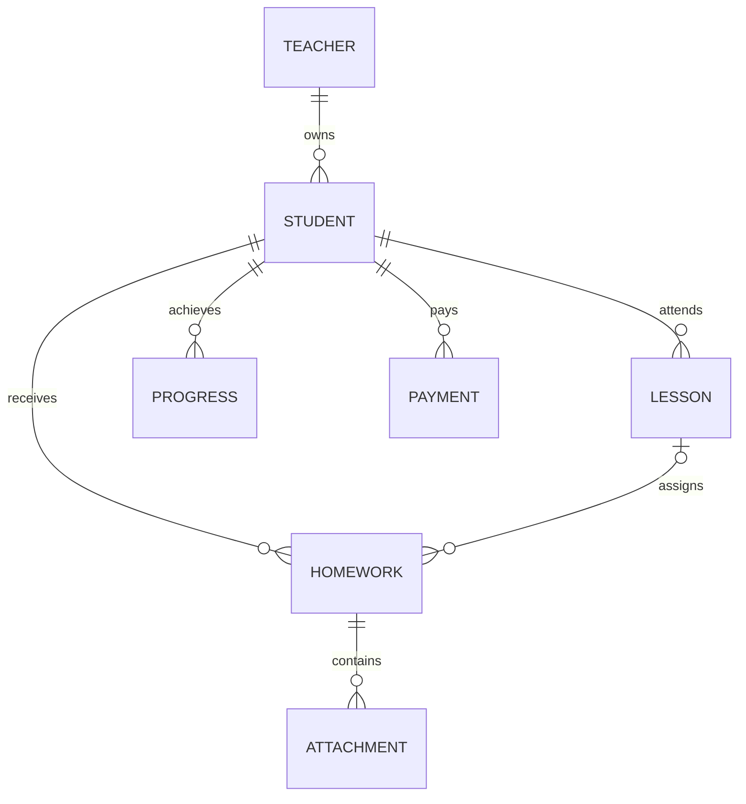

# TutorSpace 1.0

Рабочее веб-приложение для личной практики репетитора. Начальная ставка — 800 рублей в час; при создании серии занятий предложены понедельник и пятница.

## Устройство

Интерфейс: React 19, TypeScript и адаптивная CSS-сетка. Сервер: Vinext на Cloudflare Workers. Структурированные данные: Cloudflare D1. Вложения: приватный R2. Вход: Sign in with ChatGPT, авторизация владельца на каждом серверном запросе. Сайт публикуется с доступом только владельцу.

В рабочей версии используются возможности доступного хостинга. Это архитектурное отличие от первоначального ТЗ: D1 вместо PostgreSQL, проверка владельца на сервере вместо PostgreSQL RLS, платформенный вход вместо собственной системы паролей. Эти различия нужно согласовать с преподавателем перед формальной приемкой по исходному ТЗ. Первая рабочая версия не является подтверждением полного выполнения всех инфраструктурных нормативов ТЗ.

## Модель данных

Идентификаторы — UUID. Суммы хранятся целыми числами в копейках. Даты сохраняются в UTC ISO 8601, интерфейс показывает местное время браузера. Повторения вычисляются в московском часовом поясе UTC+3; это явно указано в форме.

Баланс = сумма оплат − сумма стоимости проведенных занятий. Отмененные и запланированные уроки не участвуют в начислении. При редактировании проведенного урока его стоимость сохраняется. Ученик архивируется с сохранением истории.

Пересечения проверяются на сервере и SQLite-триггерами внутри транзакции. Интервалы полуоткрытые: занятие с 15:00 до 16:00 не мешает следующему с 16:00. При конфликте серии ни одно из ее занятий не создается. Редактирование существующего занятия меняет только выбранную запись серии.

## API

Все маршруты требуют авторизованной сессии. Владелец определяется исключительно из платформенной идентичности, не из JSON клиента.

| Запрос | Назначение |
|---|---|
| GET /api/data | Все записи и настройки текущего владельца |
| POST /api/data | Создание и изменение записей; действия save, delete, preferences |
| POST /api/files | Загрузка вложения к доступному владельцу заданию, multipart/form-data |
| GET /api/files?id=UUID | Скачивание доступного владельцу вложения |

Пример создания занятия: `{ "kind": "lessons", "action": "save", "requestId": "UUID", "data": { "studentId": "UUID", "start": "2026-11-20T14:00:00.000Z", "duration": 60, "subject": "Математика", "topic": "Уравнения", "status": "planned", "price": 80000 } }`.

При повторениях добавляется `repeat: {days: [1, 5], until: "2027-02-18T20:59:59.000Z"}`. Максимум 110 записей за операцию и год вперед. `requestId` защищает повторную отправку формы от дублирования записи. Для изменения передается `id`. Полный набор полей формируется клиентским редактором, сервер их проверяет заново.

Удаление ученика, занятия и оплаты через API заблокировано: используются архивирование, отмена и изменение ошибочной оплаты. Просрочка задания вычисляется из срока и статуса на клиенте; у проверенного задания есть комментарий и дата проверки.

## Эксплуатация

Данные не сохраняются в localStorage. Экспорт JSON доступен в настройках; CSV балансов — в оплатах. Сами файлы в JSON не включены, их нужно скачать отдельно. Экспорт записей не заменяет управляемое резервное копирование сервера.

Не заявляются как проверенные: ежедневные резервные копии с хранением 30 дней, восстановление менее часа, crash-free rate 99,8%, все браузеры из ТЗ, порог загрузки 2 секунды на заданном канале и доступность WCAG AA по всему интерфейсу. Нужны отдельная настройка инфраструктуры и формальные измерения. Кабинеты учеников, видеосвязь и банковский эквайринг, как и в ТЗ, не включены.
